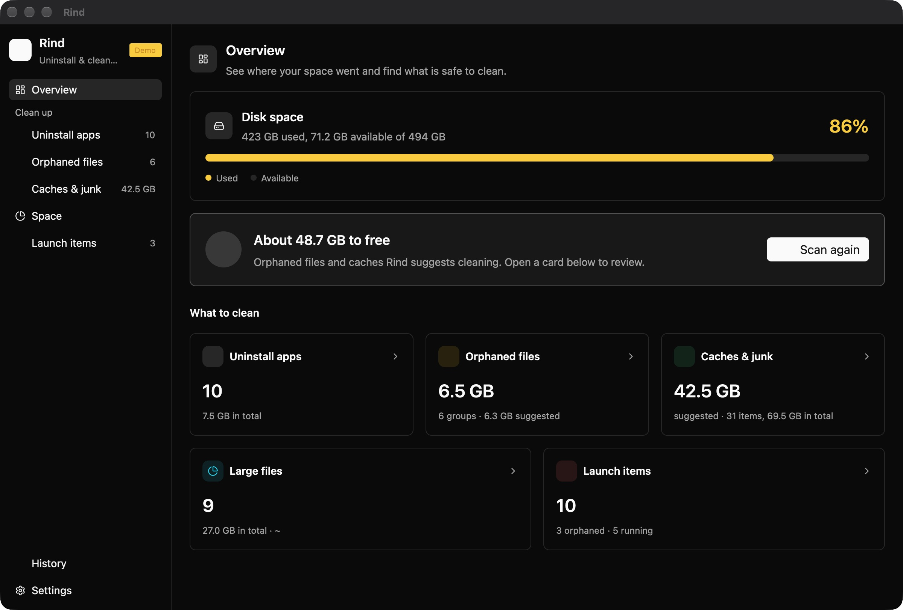
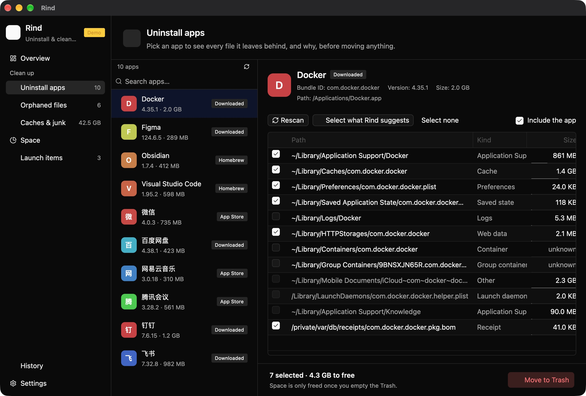
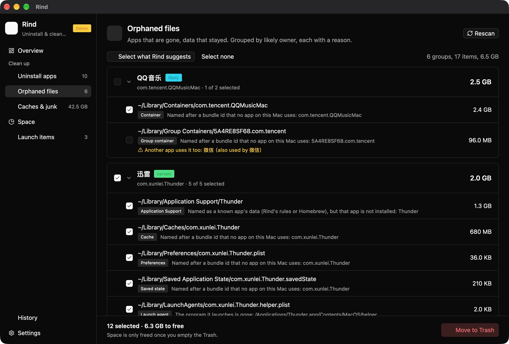
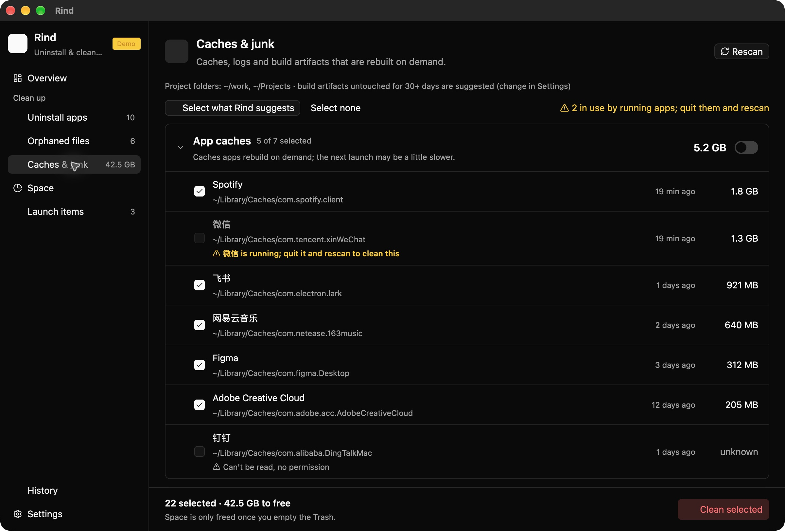
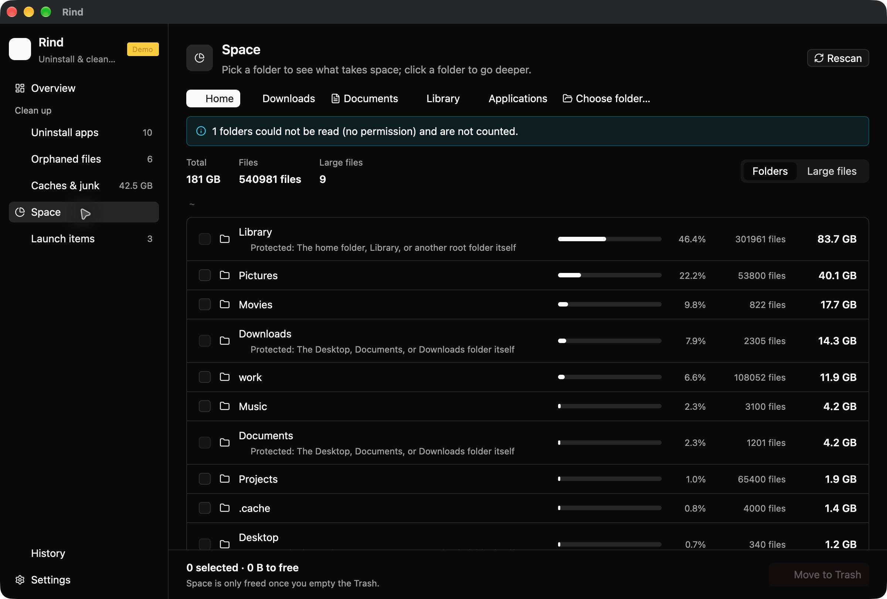
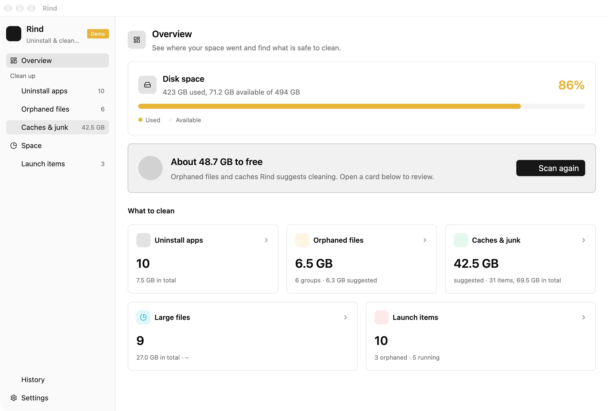

# Rind

**English** | [简体中文](README.zh-CN.md)

Uninstall Mac apps together with every file they leave behind — and **say why each file belongs
to the app, and how sure Rind is**. Everything is moved to the Trash, never deleted outright;
History puts it back in one click. Written in Rust, with a GPUI interface.

It learns from [Peel](https://github.com/TuguiDragos/Peel) (per-file evidence and protected
areas), [Mole](https://github.com/tw93/Mole) (CLI-first, `--dry-run`),
[Tencent Lemon](https://github.com/Tencent/lemon-cleaner) (data-driven cleanup rules) and
[Pearcleaner](https://github.com/alienator88/Pearcleaner) (the app itself), then redoes it by
its own rules: **explainable, undoable, conservative defaults, and a dry run that equals the
real run**.

> Status: **0.2.0**. A DMG is available (unsigned — see Install); you can also build from source.

## Preview

What it looks like (sample data via `RIND_DEMO=1`, nothing on your real system is touched):



| Uninstall: a reason and a confidence for every file | Orphans: files left behind by deleted apps |
| --- | --- |
|  |  |

| Cleanup: expensive-to-rebuild caches are listed but not checked | Space: what actually fills the disk |
| --- | --- |
|  |  |

An animated loop of every page: [docs/images/en/demo.gif](docs/images/en/demo.gif).
Light / dark follows the system, or you can pin it in Settings:



## What it does

- **Uninstall**: the app plus its leftovers, with a reason per item (bundle id, embedded
  components, App Groups, signing Team, Homebrew cask, pkg receipts) and a confidence
  (certain / likely / possible).
- **Orphans**: files left behind by apps you already deleted — including apps just moved to
  the Trash.
- **Cleanup**: caches, logs, browser caches, Xcode, package-manager caches, project build
  artifacts; things that are expensive to rebuild are listed but never pre-checked.
- **Space**: what takes up the most room and where the big files are (real usage after
  de-duplicating APFS clones and hard links).
- **Launch items**: see, disable and remove LaunchAgents / LaunchDaemons.
- **The CLI and the GUI use the same judgement**: `rind` has 12 subcommands, all with
  `--json`, and everything that moves files supports `--dry-run`.

## Safety principles

- **Trash only.** Every item moves via `NSFileManager.trashItem`; History records where it
  actually landed in the Trash so it can be put back. Nothing without a record is ever trashed.
- **Protected areas cannot be overridden by any selection**: iCloud Drive, Keychains, SSH /
  GPG keys, Mail, Messages, Safari, Photos and Music libraries, iPhone backups, the Desktop /
  Documents / Downloads folders themselves, system paths, and browser profiles with crypto
  wallets. `rind protected` lists them all.
- **It does not guess for you.** Only certain / likely items that no other app shares and whose
  size is known are pre-checked; unreadable directories report “unknown”, never 0.
- **It checks once more before moving.** The resolved on-disk path must match what was scanned,
  or the move is refused; a folder that contains anything protected is refused as a whole.
- No account, no telemetry, no background daemon — if you do not press the button, it does
  nothing.

The details (including known limits) are in [docs/SAFETY.md](docs/SAFETY.md) (Chinese).

## Install

**Download the DMG (recommended)**: grab the latest `Rind-v*.dmg` from
[Releases](https://github.com/ahjdzx/rind/releases) and drag Rind into Applications.
The DMG is built by GitHub Actions on Apple Silicon (arm64) and is **not signed or notarized
with a Developer ID** — the first launch needs right-click → Open, after that it behaves
normally. Requires macOS 14+ (development and testing happen on macOS 26). Intel Macs are
untested.

**Build from source**: needs macOS and Rust 1.85+. A full Xcode is **not** required
(GPUI compiles its Metal shaders at runtime).

```sh
git clone git@github.com:ahjdzx/rind.git
cd rind
cargo build --release -p rind-cli      # the `rind` CLI
cargo build --release -p rind-app      # the desktop app
cargo test --workspace --exclude rind-app
```

To build a DMG yourself: `scripts/package-dmg.sh` (output in `target/dmg/Rind-v<version>.dmg`).

## Try it (read-only)

```sh
./target/release/rind status             # disk + number of uninstallable apps
./target/release/rind leftovers WeChat   # what WeChat left behind, and why each file is its
./target/release/rind protected          # what it will never touch

RIND_DEMO=1 cargo run -p rind-app        # the desktop app, sample data, nothing is touched
```

`rind status --scan` also scans for orphans and cleanable items; `--help` lists every flag.

## The `rind` command

```
view      apps · leftovers · protected · history · status · analyze · launch list
uninstall uninstall <app>          [--dry-run] [--yes] [--all] [--keep-app] [--quit] [--force-quit]
orphans   orphans                  [--trash] [--all] [--path P] [--dry-run] [--yes]
clean     clean                    [--trash] [--category C] [--project-root D] [--min-age N] [--dry-run] [--yes]
any file  trash <path>...          [--dry-run] [--yes]
restore   restore <id>
launch    launch list|disable|enable|remove <label>...

global: --json (for scripts and agents) · --lang zh|en
```

Full documentation (Chinese): [docs/USAGE.md](docs/USAGE.md).

## Rules

`rules/*.toml` add app-specific cleanup paths (Chinese-market apps first) and are baked in at
build time. Rules can only **add** evidence; they can never bypass a protected area. See
[CONTRIBUTING.md](CONTRIBUTING.md) to add one.

## Documentation

All of it is in Chinese for now.

| Document | Contents |
| --- | --- |
| [docs/USAGE.md](docs/USAGE.md) | Manual: install, UI, every command, file locations, FAQ |
| [docs/DESIGN.md](docs/DESIGN.md) | Design: goals and non-goals, information architecture, interaction and visuals |
| [docs/SAFETY.md](docs/SAFETY.md) | Safety model: the single exit, protected areas, History, known limits, how to verify |
| [docs/ARCHITECTURE.md](docs/ARCHITECTURE.md) | Technical architecture: what happens during an uninstall, module contracts |
| [docs/ROADMAP.md](docs/ROADMAP.md) | Milestones and candidates |
| [CHANGELOG.md](CHANGELOG.md) | Changes per release |

## Contributing

- Process and the “invariants that must not break”: [CONTRIBUTING.md](CONTRIBUTING.md)
- Security issues: report privately via [SECURITY.md](SECURITY.md)
- Code of conduct: [CODE_OF_CONDUCT.md](CODE_OF_CONDUCT.md) (Contributor Covenant 2.1)

## License

GPL-3.0-or-later, see [LICENSE](LICENSE).

## Acknowledgements

Peel, Mole, Tencent Lemon and Pearcleaner walked this road first; Rind stands on their
experience. The UI layer is GPUI and
[gpui-component](https://github.com/longbridge/gpui-component).
